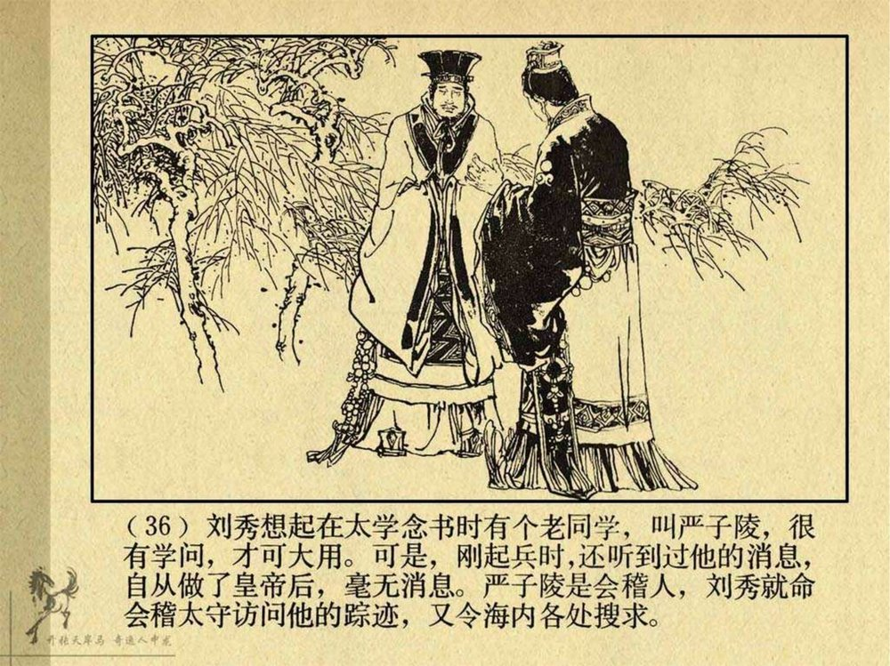
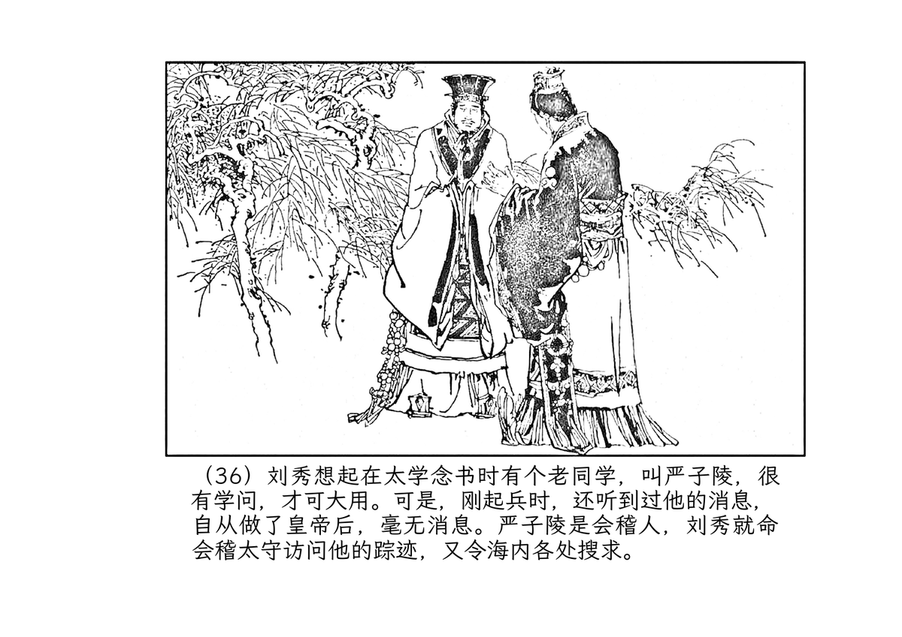
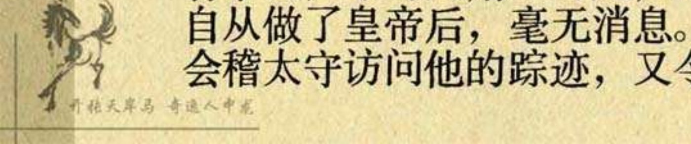
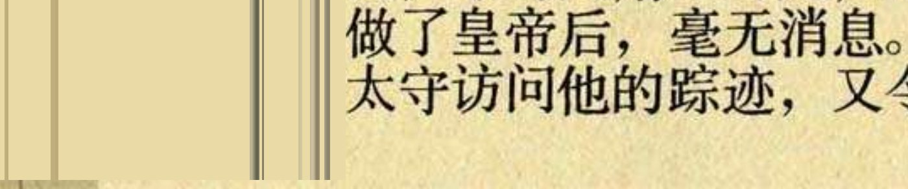

# scanned-book-retypeset

> Retypeset scanned Chinese books into clean, print-ready A4 PDFs — 扫描版古籍 / 连环画 → 可印刷 A4 数字化重排

An end-to-end, **100% config-driven** pipeline that rebuilds a scanned book
PDF (连环画 / 古籍 / 旧版印书) into a modern, print-ready A4 PDF that stays
**1:1 with the original page layout**: every figure sits where it was, every
text line lands on its original baseline, margin design elements are
redrawn, and each page passes machine-checked QA before the book is merged
and optimized.

把扫描版书籍（连环画、古籍、二十世纪印本）重建为现代、可印刷、文字可选的
A4 版式，且与原件**版面 1:1 对应**：图在原来的位置、每行文字落在原始基线、
页边设计元素重绘、每一页通过机器校验后合订并做 Ghostscript 优化。

## 效果 (Results)

| 原扫描件（泛黄、带水印、位图文字） | 重排输出（A4、清晰、文字可选） |
|---|---|
|  |  |

水印去除（后期扫描水印 vs 原书设计 由"水印判断子技能"区分）：

| 去除前（马形水印 + 口号 + 细线） | 去除后（原页缘竖线保留） |
|---|---|
|  |  |

## 特性 (Features)

- **版面 1:1 重建**：250 dpi 渲染 → 几何测量（倾斜校正、图框多边形、文字带）
  → 文字基线按"原始墨行"对齐 → reportlab 排版，输出与原件逐坐标对应
- **图像处理双变体**：`bw_clear`（去黄、提白、锐化，保留网点质感）与
  `vector`（矢量化高对比黑白，"新印刷"观感）；彩色图/彩色页保持原色不动
- **文字可选**：重排文字为真实文本（嵌入 LXGW 文楷字体），`pdftotext` 可提取
- **逐页机器 QA**：图框偏差 <4%、文字位置偏差 <5%、文本内容一致、
  面板号锚点校验，全部记录在 `data/verify/`
- **特殊页**：封面/扉页/内容提要/版权页由 `special_pages` 配置驱动重排
- **页边设计保真**：右栏/左栏 running design（版心线、边线、藏书印等）
  自动检测、逐页裁剪重绘 1:1
- **水印判断子技能**：整书通读后识别后期扫描水印（OCR 行重复 + 模板匹配 +
  跨册对照），默认去除、客户意见优先；`watermark_boxes` / `whiteout_boxes` /
  `erase_tmpl`（模板反混合）/ `erase_ink` 多机制配置驱动去除
- **GPU 批量 OCR**：通过 PaddleOCR MCP（VL 版面解析 + 行级 OCR）批量推理，
  单卡 T4 上 200 页级书籍 ~15 分钟
- **并行批处理**：`batch_runpages.sh` 按 CPU 核数并行跑逐页管线

## 流水线 (Pipeline)

| 脚本 | 作用 |
|---|---|
| `00_batch_prepare.py` | 全页 250dpi 渲染 + 面板页几何 + 文字带裁剪（MCP OCR 输入） |
| `01_render.py` | 单页/全页 PDF→PNG 渲染（poppler） |
| `02_geometry.py` | 倾斜校正、图框轮廓（多边形）、文字带检测 → `pNNN.geo.json` |
| `03_enhance.py` | 图区裁剪与增强（去黄/矢量化/彩色保持）；水印白化；页边条裁剪 |
| `04_merge.py` | 几何 + VL 版面 + OCR 行 → 逐页数据集 `pNNN.json`（1:1 映射） |
| `05_typeset.py` | reportlab 重建页面（图 1:1 + 文字按原始基线 + 页边条重绘） |
| `06_verify.py` | 逐页 QA（图框/文字/内容/锚点），写 `verify/pNNN.json` |
| `07_special.py` | 特殊页（封面/扉页/提要/版权页）重排，配置驱动 |
| `08_batch_infer.py` | PaddleOCR MCP 批量 GPU 推理（VL + OCR），结果落盘 |
| `run_page.py` | 单页完整管线：03→04→05→06 + 预览对比 |
| `batch_runpages.sh` | 面板页并行批处理（默认 6 路） |
| `test_pages.py` | 逐页复现断言（坐标比例、文本内容、面板号） |

数据流：`src.pdf → data/pages/ (250dpi) → data/layout/ (几何+OCR+数据集) →
data/images/ (增强图) → out/pages/ (逐页 PDF) → 合并 → Ghostscript 优化`。

## 仓库结构 (Layout)

```
scanned-book-retypeset/
├── SKILL.md                    # pi coding agent 技能入口（含工作流与陷阱清单）
├── references/                 # 详细文档
│   ├── workflow.md             #   完整工作流（逐阶段）
│   ├── config.md               #   配置全字段说明
│   ├── watermark.md            #   水印判断子技能（识别/判定/去除）
│   ├── pitfalls.md             #   踩坑清单（35 条，含复现与对策）
│   ├── performance.md          #   性能数据与并行策略
│   └── scribus.md              #   Scribus MCP 手工精修（可选）
├── scripts/
│   ├── pipeline/               # ← 整体拷贝到 <book>/pipeline/
│   │   ├── 00_batch_prepare.py … 08_batch_infer.py
│   │   ├── run_page.py
│   │   ├── config.example.json #   配置模板（含字段级注释）
│   │   └── lib/common.py       #   路径/坐标/数据加载
│   ├── batch_runpages.sh       # ← 拷贝到 <book>/（书根目录）
│   └── test_pages.py           # ← 拷贝到 <book>/
├── examples/                 # 案例书配置 + 案例笔记（config 参考样板）
│   ├── lianhuanhua/          #   《龙子太郎》（vector 变体基准书）
│   ├── nezha/                #   《哪吒》（左栏 running design、印章）
│   ├── paris/                #   《巴黎圣母院》（dot 编号、无号页、整版底图）
│   └── liuxiu/               #   《刘秀》下册（重泛黄 + 全册水印 + erase_tmpl）
├── CHANGELOG.md              # 版本记录
├── install.sh                # 安装为 pi 技能（SKILL.md + references + scripts）
├── docs/samples/             # 效果样张（本仓库 README 用）
├── requirements.txt
└── LICENSE
```

## 依赖 (Dependencies)

**Python（书籍项目本地 `.venv`）** — 见 `requirements.txt`：
`numpy`、`opencv-python-headless`、`pillow`、`reportlab`

**系统工具**：
- [poppler-utils](https://poppler.freedesktop.org/) — `pdftoppm` / `pdfinfo` /
  `pdftotext` / `pdffonts` / `pdfunite`
- [Ghostscript](https://ghostscript.com/) — 合订后优化
- 字体：LXGW WenKai（`font` 配置指向 ttf 路径）
- 可选：[potrace](http://potrace.sourceforge.net/)（`vector` 变体轮廓矢量化）、
  Scribus（MCP 手工精修，见 `references/scribus.md`）

**OCR 后端**：[paddleocr-mcp](https://github.com/Nicvank/paddleocr-mcp) server
（`paddleocr_mcp_server.py`，含 paddlepaddle-gpu + PaddleOCR-VL）。
`08_batch_infer.py` 直接以模块方式调用同一代码路径，避免 2N 次 MCP 往返；
单卡环境运行前请停掉常驻 MCP 服务进程。

## 快速开始 (Quickstart)

```bash
# 1) 建立书籍项目
mkdir -p mybook/pipeline && cp -r scanned-book-retypeset/scripts/pipeline/* mybook/pipeline/
cp scanned-book-retypeset/scripts/batch_runpages.sh scanned-book-retypeset/scripts/test_pages.py mybook/
cp mybook_src.pdf mybook/src.pdf

# 2) Python 环境
python3 -m venv mybook/.venv
mybook/.venv/bin/pip install -r scanned-book-retypeset/requirements.txt

# 3) 写配置（逐字段注释见 scripts/pipeline/config.example.json）
cp scanned-book-retypeset/scripts/pipeline/config.example.json mybook/pipeline/config.json
#    按本书修改: source_pdf / total_pages / panel_pages / panel_no_* /
#    a4 / font / enhance / mcp / special_pages ...
#    （通读全书后运行"水印判断子技能"，必要时填 watermark_boxes，
#     见 references/watermark.md）

# 4) 渲染 + 几何 + 文字带
mybook/.venv/bin/python mybook/pipeline/00_batch_prepare.py

# 5) GPU 批量 OCR（用 MCP venv 的 python；先停常驻 MCP 服务）
~/paddleocr-mcp/.venv/bin/python mybook/pipeline/08_batch_infer.py all

# 6) 面板页并行批处理
cd mybook && JOBS=6 bash batch_runpages.sh

# 7) 特殊页
.venv/bin/python pipeline/07_special.py all

# 8) 合并 + Ghostscript 优化
pdfunite $(cat out/merge_list.txt) out/book_merged.pdf
gs -sDEVICE=pdfwrite -dCompatibilityLevel=1.5 -dPDFSETTINGS=/prepress \
   -dDownsampleColorImages=true -dColorImageResolution=200 \
   -dDownsampleGrayImages=true -dGrayImageResolution=200 \
   -dDownsampleMonoImages=true -dMonoImageResolution=200 \
   -dAutoRotatePages=/None -dNOPAUSE -dBATCH \
   -sOutputFile=out/book_final.pdf out/book_merged.pdf
```

逐页调试：`.venv/bin/python pipeline/run_page.py --page 10`（含预览对比图）；
逐页断言：`.venv/bin/python test_pages.py 10`。

完整逐阶段工作流（含每步验收标准与常见故障）见 `references/workflow.md`。

## 配置 (Configuration)

管线 100% 由 `pipeline/config.json` 驱动，无书籍相关硬编码。关键字段：

| 字段 | 说明 |
|---|---|
| `source_pdf` / `total_pages` / `drop_pages` / `panel_pages` | 书页清单 |
| `panel_no_offset` / `panel_no_format` | 面板号与页码映射（bare/paren/dot） |
| `a4` | 输出幅面与边距（横/竖版均可） |
| `font` / `font_pt` / `ink_em` / `asc_em` | 字体与基线度量 |
| `enhance.variant` | `bw_clear` / `vector`；`color_auto` 控制彩色图路由 |
| `margin_strip` | 页边 running design 自动裁剪重绘（左右栏） |
| `watermark_boxes` | 后期扫描水印白化框 + OCR 行丢弃规则 |
| `mcp` | PaddleOCR MCP server 路径 |
| `special_pages` | 特殊页处理器（cover_as_is / retype / title_page / colophon） |

全字段与默认值：`scripts/pipeline/config.example.json`（字段级注释）与
`references/config.md`。

## 性能参考 (Performance)

| 书 | 页数 | GPU | 渲染 | 批量 OCR | 面板页批处理 | 备注 |
|---|---|---|---|---|---|---|
| 巴黎圣母院 | 213 | T4 | — | — | — | 全程 ~84 min |
| 刘秀 上册 | 156 | T4 | — | ~15 min | ~10 min | 洁净纸 |
| 刘秀 下册 | 164 | T4 | 两书合计 ~21 min | ~15.5 min | ~4 min | 重泛黄 + 全册水印去除重跑 |

并行度：渲染/OCR 为 IO+GPU 受限（GPU 批量推理为瓶颈），逐页排版为 CPU 受限
（`JOBS` 按核数）。详见 `references/performance.md`。

## 作为 pi 技能使用 (As a pi skill)

`SKILL.md` 是 [pi coding agent](https://github.com/badlogic/pi-mono) 的技能入口：
把本仓库放入技能目录后，当用户说"重排这本扫描书"时助手会按
`SKILL.md` + `references/workflow.md` 执行全流程（含水印判断子技能、
多书会话规则、35 条陷阱清单）。

## 许可证 (License)

[MIT](LICENSE) — 版本记录见 [CHANGELOG.md](CHANGELOG.md)。
